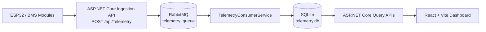

# IoT Smart Battery Management System (BMS) & Telemetry Platform

An end-to-end telemetry platform for LiFePO4 battery packs. The project connects IoT battery data ingestion with asynchronous processing, persistent storage, secure APIs, and a React dashboard for monitoring and diagnostics.

## Table of Contents
- [Overview](#overview)
- [Main Features](#main-features)
- [Architecture](#architecture)
- [Technology Stack](#technology-stack)
- [Repository Structure](#repository-structure)
- [Prerequisites](#prerequisites)
- [Local Setup and Run Guide](#local-setup-and-run-guide)
- [Secure Configuration (Secrets)](#secure-configuration-secrets)
- [Data Seeding](#data-seeding)
- [BMS Stress Test Simulator](#bms-stress-test-simulator)
- [API Endpoints](#api-endpoints)
- [Screenshots (Placeholders)](#screenshots-placeholders)
- [Current Limitations](#current-limitations)
- [Future Improvements](#future-improvements)
- [License](#license)

## Overview
This solution bridges ESP32 + BMS hardware telemetry and a modern web dashboard.

Telemetry messages are ingested by an ASP.NET Core API, pushed into RabbitMQ (`telemetry_queue`), processed by `TelemetryConsumerService`, persisted to SQLite, and then exposed back to the frontend through secured API endpoints.

## Main Features
- Real-time style telemetry ingestion through HTTP + RabbitMQ buffering.
- Asynchronous backend processing using a dedicated consumer service.
- SQLite persistence for BMS modules, user settings, and telemetry history.
- JWT authentication for protected API routes.
- Password hashing with BCrypt.Net-Next.
- Email alert capability via MailKit.
- Interactive React dashboard with routing and Recharts-based telemetry charts.
- Built-in stress-test console app for simulated BMS traffic.

## Architecture


## Technology Stack
### Backend
- .NET 8
- ASP.NET Core Web API
- Entity Framework Core
- SQLite
- RabbitMQ.Client
- JWT Authentication
- BCrypt.Net-Next
- MailKit
- Swagger / OpenAPI

### Frontend
- React
- Vite
- React Router
- Recharts
- Tailwind CSS

### Simulation
- `BmsStressTest` (.NET 8 console app) for telemetry load simulation.

## Repository Structure
```text
TelemetryApi/
├── TelemetryApi/         # ASP.NET Core API + background telemetry consumer
├── frontend/             # React + Vite dashboard
├── BmsStressTest/        # Console telemetry simulator/stress test
└── docker-compose.yml    # Local infrastructure (RabbitMQ + PostgreSQL service definitions)
```

## Prerequisites
- Git
- .NET 8 SDK
- Node.js + npm
- Docker (for RabbitMQ via container)

## Local Setup and Run Guide
### 1) Clone the repository
```bash
git clone https://github.com/RazvanMurgu27/TelemetryApi.git
cd TelemetryApi
```

### 2) Start RabbitMQ (recommended: Docker Compose)
From the repository root:

```bash
docker compose up -d rabbitmq
```

Open RabbitMQ Management UI at `http://localhost:15672` (default credentials in compose file are `guest` / `guest`).

Optional standalone Docker command:
```bash
docker run -d --name telemetry_rabbitmq -p 5672:5672 -p 15672:15672 rabbitmq:3-management
```

### 3) Run the backend (`TelemetryApi/`)
```bash
cd TelemetryApi
dotnet restore
dotnet run
```

Swagger/OpenAPI is available in Development mode at:
- `https://localhost:<BACKEND_PORT>/swagger`

Check the actual HTTPS port in terminal output or in `TelemetryApi/Properties/launchSettings.json`.

### 4) Run the frontend (`frontend/`)
In a new terminal from the repository root:

```bash
cd frontend
npm install
```

Create `frontend/.env`:
```env
VITE_API_URL=https://localhost:<BACKEND_PORT>
```

Start the frontend:
```bash
npm run dev
```

Open the URL shown by Vite in your terminal (commonly `http://localhost:5173`).

## Secure Configuration (Secrets)
Do **not** commit real secrets.

Set sensitive values via .NET User Secrets (recommended for local development) or environment variables:
- `Jwt:Key`
- `EmailSettings:Email`
- `EmailSettings:Password`

Example (`TelemetryApi/` folder):
```bash
dotnet user-secrets init
dotnet user-secrets set "Jwt:Key" "replace-with-a-long-random-key"
dotnet user-secrets set "EmailSettings:Email" "your-email@example.com"
dotnet user-secrets set "EmailSettings:Password" "your-app-password"
```

## Data Seeding
At startup, the backend:
1. Ensures the SQLite database is created.
2. Seeds demo data **only when the database is empty**.
3. Adds a demo BMS module (`SIM-001`), time-series telemetry history, and anomaly scenarios (for alert visualization/testing).

To inspect or change demo values, edit:
- `TelemetryApi/Data/DataSeeder.cs`

For security, this README intentionally does not expose demo credentials.

## BMS Stress Test Simulator
Run from the repository root:
```bash
dotnet run --project BmsStressTest
```

The simulator supports:
- Optional custom `DeviceId` (or random `SIM-001` ... `SIM-050`).
- Battery topology selection:
  - 12V (4S)
  - 24V (8S)
  - 48V (16S)
- Configurable publish interval (milliseconds).
- RabbitMQ publication to `telemetry_queue`.

Stop the simulator with `CTRL+C`.

## API Endpoints
Routes below match the existing controllers.

### Public endpoints
- `POST /api/Auth/register`
- `POST /api/Auth/login`
- `POST /api/Telemetry`

### JWT-protected endpoints
- `GET /api/Telemetry/battery/{deviceId}`
- `POST /api/Bms`
- `GET /api/Bms/user/{userId}`
- `DELETE /api/Bms/user/{deviceId}`
- `GET /api/Settings/battery/{deviceId}`
- `PUT /api/Settings`

Send a valid JWT in the `Authorization` header for protected routes.

## Screenshots (Placeholders)
Add screenshots in this section after capture. Recommended set:

1. **Dashboard Overview** — battery list and live status cards.
2. **Battery Details & Charts** — per-battery telemetry view with voltage/current/temperature/SOC charts.
3. **Settings** — battery thresholds and alert configuration form.
4. **Swagger / OpenAPI** — available endpoints and authenticated request example.
5. **RabbitMQ Management** — `telemetry_queue` status in the management UI.

## Current Limitations
- Current infrastructure is optimized for local/dev usage (SQLite + local RabbitMQ host assumptions).
- Queue processing reliability features (retries, dead-letter queues, advanced durability) are limited in the current implementation.
- Configuration and deployment hardening for production environments is not yet fully documented.

## Future Improvements
- Add production-ready RabbitMQ topology (durable queues, DLQ, retry strategy).
- Add automated tests for critical API and consumer flows.
- Expand observability (structured logs, metrics, health checks, tracing).
- Add deployment profiles (containers/cloud) with environment-specific configuration guides.

## License
No `LICENSE` file is currently defined in this repository.
