# TelemetryEngine

**IoT battery telemetry platform: asynchronous ingestion, rule-based safety monitoring and a real-time dashboard.**

[](https://github.com/RazvanMurgu27/TelemetryApi/actions/workflows/main_telemetry-api-razvan-27.yml)
[](https://github.com/RazvanMurgu27/TelemetryApi/actions/workflows/main_telemetry-frontend-web.yml)

[](https://dotnet.microsoft.com/)
[](https://react.dev/)
[](https://www.postgresql.org/)
[](https://www.rabbitmq.com/)
[](https://www.docker.com/)
[](https://azure.microsoft.com/)

Battery devices publish measurements to the API, which validates and queues them. A background
consumer evaluates safety rules and sends alerts, and a React dashboard shows the latest state
and the history of each battery.

## Table of contents

- [Live demo](#live-demo)
- [Highlights](#highlights)
- [Architecture](#architecture)
- [Tech stack](#tech-stack)
- [Run locally](#run-locally)
- [Demo data and credentials](#demo-data-and-credentials)
- [API overview](#api-overview)
- [BMS stress-test simulator](#bms-stress-test-simulator)
- [CI/CD and Azure deployment](#cicd-and-azure-deployment)
- [Repository structure](#repository-structure)
- [Screenshots](#screenshots)
- [Roadmap](#roadmap)
- [License](#license)

## Live demo

| Component | URL |
|---|---|
| Frontend (React) | https://telemetry-frontend-web-h2hca6dnfcadbwak.francecentral-01.azurewebsites.net |
| Backend API | https://telemetry-api-razvan-27.azurewebsites.net |
| Swagger / OpenAPI | https://telemetry-api-razvan-27.azurewebsites.net/swagger |

> **Note:** the app runs on a free Azure tier, so the first request after a period of
> inactivity can take 20-30 seconds while the instance wakes up.

Sign in with the [demo credentials](#demo-data-and-credentials) below.

### Try the API from Swagger

1. Open the Swagger page and run `POST /api/Auth/login` with the demo credentials.
2. Copy the returned JWT, click **Authorize** and enter `Bearer <JWT_TOKEN>`.
3. For `POST /api/Telemetry`, authorize the API-key scheme with `telemetry-demo-key`.
   Swagger sends it as the `X-Api-Key` header.

## Highlights

- **Asynchronous ingestion:** telemetry is published to RabbitMQ before it is processed, so the
  HTTP request path stays fast.
- **Background processing:** `TelemetryConsumerService` evaluates safety rules outside the request path.
- **Separated security responsibilities:** JWT protects user and dashboard operations, while an
  API key protects hardware telemetry ingestion.
- **Configurable safety rules:** temperature, pack voltage, current, state of charge and cell
  imbalance are checked against per-battery thresholds.
- **Operational visibility:** status overview, charts, telemetry history and configured limits.
- **Repeatable demo:** a new database is seeded with a demo account, a simulated BMS module,
  historical telemetry and anomaly scenarios.
- **Automated delivery:** every change to the API or frontend is built and deployed to Azure
  by GitHub Actions.

## Architecture

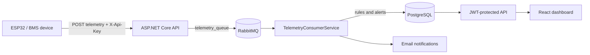

### Request flow

1. A device sends a payload to `POST /api/Telemetry`.
2. The API validates the `X-Api-Key` header and publishes the payload to `telemetry_queue`.
3. `TelemetryConsumerService` consumes the message with a scoped EF Core context.
4. Safety rules are evaluated using the battery's configured thresholds.
5. The telemetry record and any detected errors are stored in PostgreSQL.
6. Email alerts are sent for relevant safety events.
7. Authenticated users see their batteries and telemetry in the React dashboard.

## Tech stack

| Area | Technologies |
|---|---|
| API | .NET 8, ASP.NET Core Web API |
| Persistence | Entity Framework Core, PostgreSQL, Npgsql |
| Messaging | RabbitMQ, RabbitMQ.Client |
| Authentication | JWT Bearer, BCrypt.Net-Next |
| Notifications | MailKit |
| Documentation | Swagger / OpenAPI, XML documentation |
| Frontend | React, Vite, React Router, Recharts, Tailwind CSS |
| CI/CD | GitHub Actions, Azure App Service |
| Local infrastructure | Docker Compose |

## Run locally

### Prerequisites

Git, .NET 8 SDK, Node.js with npm, and Docker Desktop.

### 1. Clone the repository

```bash
git clone https://github.com/RazvanMurgu27/TelemetryApi.git
cd TelemetryApi
```

### 2. Start PostgreSQL and RabbitMQ

```bash
docker compose up -d postgres rabbitmq
```

| Service | Address |
|---|---|
| PostgreSQL | `localhost:5432` |
| RabbitMQ (AMQP) | `localhost:5672` |
| RabbitMQ Management UI | http://localhost:15672 |

Credentials for the local containers are defined in [docker-compose.yml](./docker-compose.yml).

### 3. Configure and start the API

Secrets are kept out of the repository with .NET User Secrets:

```bash
cd TelemetryApi
dotnet user-secrets init
dotnet user-secrets set "ConnectionStrings:DefaultConnection" \
  "Host=localhost;Port=5432;Database=telemetry_db;Username=app_user;Password=app_password"
dotnet user-secrets set "RabbitMQ:HostName" "localhost"
dotnet user-secrets set "Jwt:Key" "replace-with-a-long-random-development-key"
```

Email settings are optional and only needed to test alert delivery:

```bash
dotnet user-secrets set "EmailSettings:Email" "your-email@example.com"
dotnet user-secrets set "EmailSettings:Password" "your-email-app-password"
```

```bash
dotnet restore
dotnet run
```

The HTTPS URL and port are printed in the terminal. On startup the API applies pending
migrations and seeds the demo data.

### 4. Start the frontend

```bash
cd frontend
npm install
```

Create `frontend/.env` (this file is git-ignored):

```env
VITE_API_URL=https://localhost:<BACKEND_PORT>
```

```bash
npm run dev
```

Open the URL printed by Vite, usually http://localhost:5173.

## Demo data and credentials

The values below are intentionally public so the project can be evaluated without any setup.
They are for demonstration only and must never be reused in production.

| Field | Value |
|---|---|
| Email | `test@gmail.com` |
| Password | `password123` |
| Device ID | `SIM-001` |
| Hardware API key | `telemetry-demo-key` |

The demo API key is accepted only by `POST /api/Telemetry` (header `X-Api-Key`). It does not
grant access to user accounts or dashboard routes, which require a JWT.

The demo account is shared, so its data can be changed by anyone. The seeder runs only when the
`Users` table is empty and creates the demo user, the `SIM-001` module, historical telemetry and
overcurrent, overheating and cell-imbalance scenarios. See [DataSeeder.cs](./TelemetryApi/Data/DataSeeder.cs).

## API overview

### Public endpoints

| Method | Route | Purpose |
|---|---|---|
| `POST` | `/api/Auth/register` | Register a user |
| `POST` | `/api/Auth/login` | Authenticate and receive a JWT |
| `POST` | `/api/Telemetry` | Publish hardware telemetry (requires `X-Api-Key`) |

### JWT-protected endpoints

| Method | Route | Purpose |
|---|---|---|
| `GET` | `/api/Telemetry/battery/{deviceId}` | Read telemetry of an owned battery |
| `POST` | `/api/Bms` | Register a BMS module |
| `GET` | `/api/Bms/user/{userId}` | List a user's BMS modules |
| `DELETE` | `/api/Bms/user/{deviceId}` | Delete a BMS module and its telemetry |
| `GET` | `/api/Settings/battery/{deviceId}` | Read battery settings |
| `PUT` | `/api/Settings` | Update battery settings |

Protected routes expect `Authorization: Bearer <jwt-token>`.

## BMS stress-test simulator

`BmsStressTest` is a .NET console application that publishes simulated telemetry directly to the
RabbitMQ `telemetry_queue`. It supports 12 V, 24 V and 48 V battery configurations and a
configurable publish interval. It is **not** part of the deployed application or of the CI/CD pipeline.

```bash
dotnet run --project BmsStressTest
```

Follow the prompts to set the device ID, voltage and message interval. Stop it with `Ctrl+C`.

## CI/CD and Azure deployment

| Component | Hosting | Workflow |
|---|---|---|
| ASP.NET Core API | Azure App Service (Linux) | `main_telemetry-api-razvan-27.yml` |
| React SPA | Azure App Service (Windows) | `main_telemetry-frontend-web.yml` |

- Each workflow runs on pushes to `main` that change its own folder (`TelemetryApi/**` or
  `frontend/**`), and can also be started manually.
- Pipeline: `build` (restore, compile/publish) then `deploy` (only if the build succeeded).
- The frontend receives the API address at build time through `VITE_API_URL`.
- Deployment credentials are stored as GitHub Actions secrets (Azure publish profiles).
  Application secrets such as connection strings and the JWT key are configured in Azure
  and never committed.
- The frontend ships a `web.config` that rewrites client-side routes to `index.html`.

Automated tests and linting are not part of the pipeline yet (see the roadmap).

## Repository structure

```text
TelemetryApi/                  # repository root
├── .github/workflows/         # CI/CD pipelines (API and frontend)
├── docker-compose.yml         # Local PostgreSQL and RabbitMQ
├── images/                    # Screenshots used in this README
├── TelemetryApi/
│   ├── Attributes/            # API-key authorization filter
│   ├── Controllers/           # Auth, telemetry, BMS and settings endpoints
│   ├── Data/                  # EF Core context and demo data seeder
│   ├── Migrations/            # EF Core migrations
│   ├── Models/                # Users, batteries, settings, telemetry records
│   ├── Services/              # RabbitMQ, email and background consumer services
│   ├── Program.cs             # API and dependency-injection configuration
│   └── TelemetryApi.csproj
├── BmsStressTest/             # Telemetry publisher / stress-test simulator
└── frontend/
    ├── public/                # Static assets and web.config
    └── src/                   # React pages and components
```

## Screenshots

| Dashboard | Battery charts |
|---|---|
| 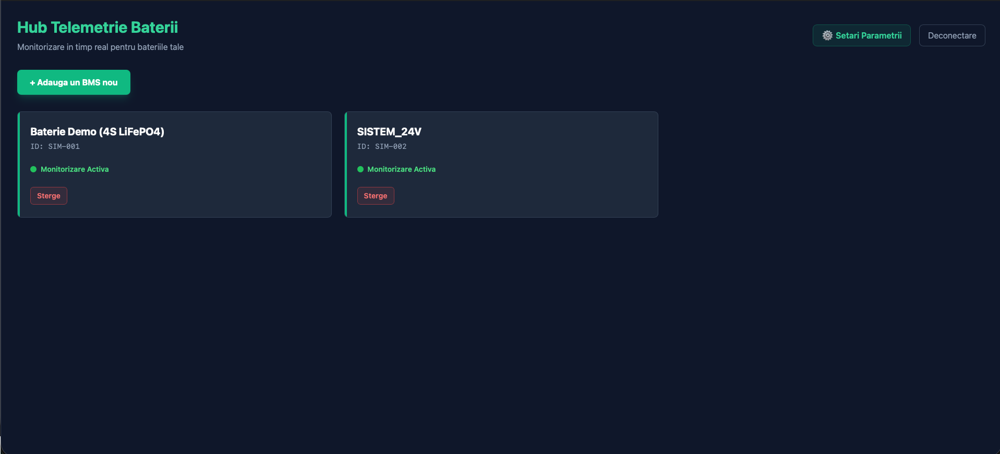 | 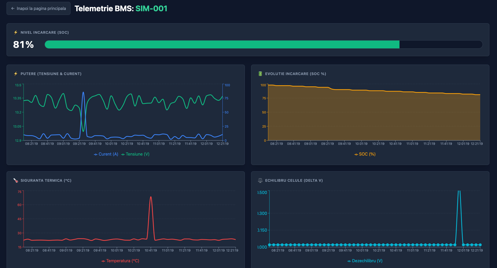 |

| Telemetry history | Battery safety settings |
|---|---|
| 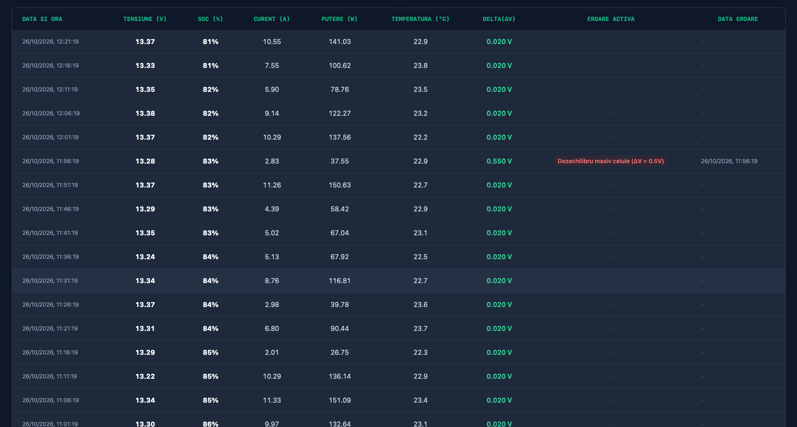 | 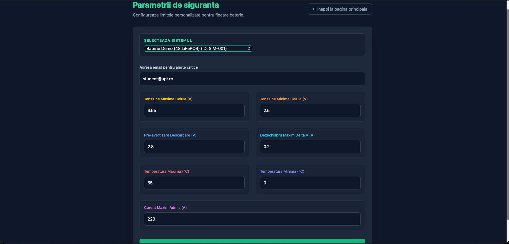 |

<details>
<summary>More: login, Swagger, RabbitMQ and stress test</summary>

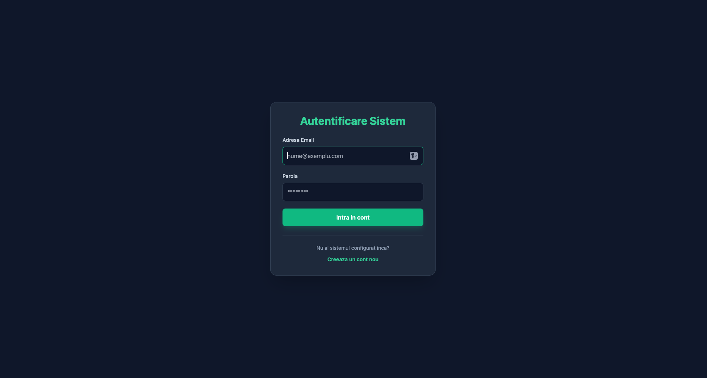

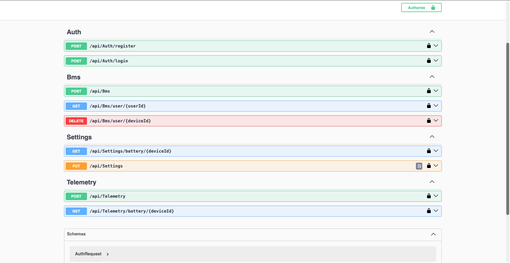
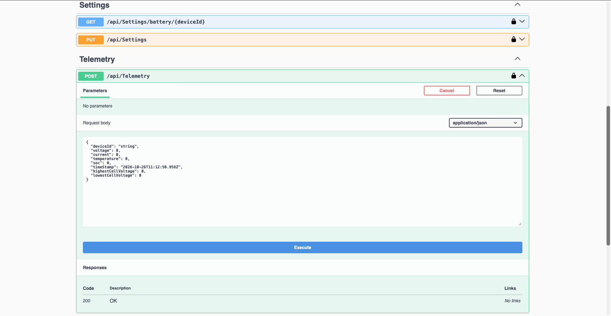
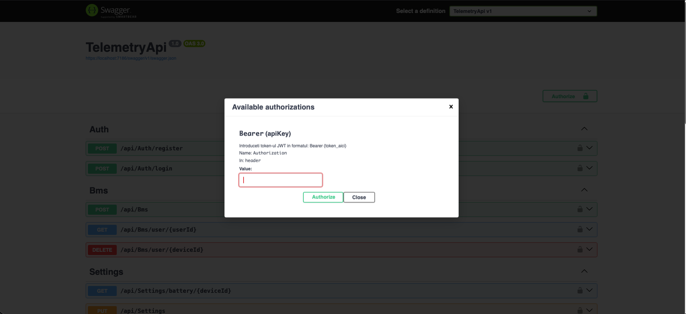

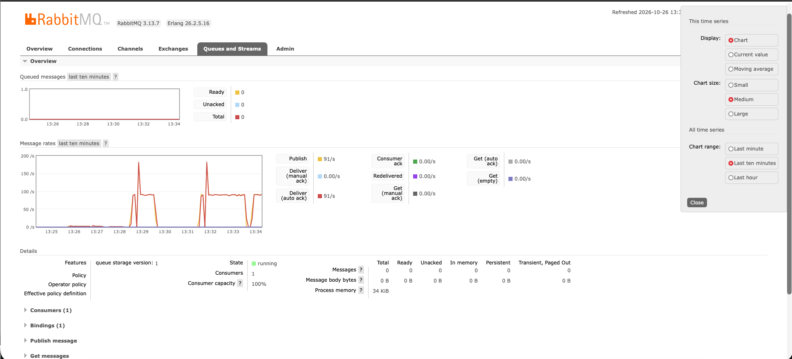

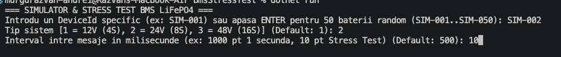
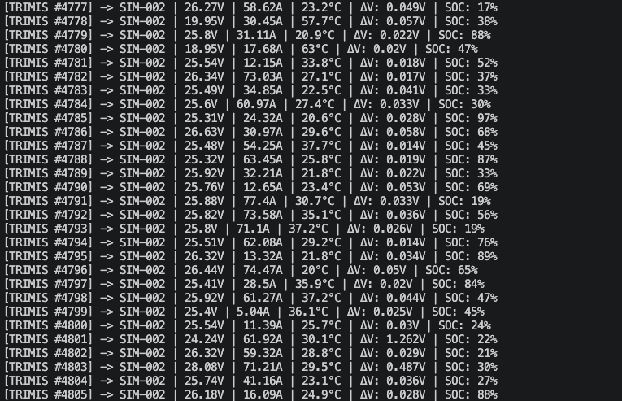
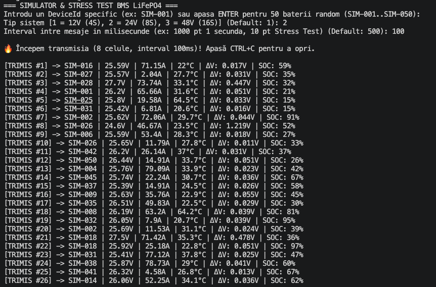

</details>

## Roadmap

This is a portfolio project. Before production use, the next steps would be:

- unit, integration and end-to-end tests, run in the CI pipeline before deployment;
- durable RabbitMQ queues with retries and dead-letter handling;
- rate limiting and per-device API keys with ownership checks;
- health checks, structured logging, metrics and tracing;
- managed secret storage (for example Azure Key Vault);
- database backups, migration strategy and monitoring.

## License

Released under the MIT License. See [LICENSE](./LICENSE).