# IoT Smart Battery Management System (BMS) & Telemetry Platform


An end-to-end telemetry platform for LiFePO4 battery packs. The project connects IoT battery data ingestion with asynchronous processing, persistent storage, secure APIs, and a React dashboard for monitoring and configuration.


## Table of Contents

- [Overview](#overview)
- [Main Features](#main-features)
- [Architecture](#architecture)
- [Technology Stack](#technology-stack)
- [Repository Structure](#repository-structure)
- [Prerequisites](#prerequisites)
- [Local Setup and Run Guide](#local-setup-and-run-guide)
- [Secure Configuration](#secure-configuration)
- [Data Seeding](#data-seeding)
- [BMS Stress Test Simulator](#bms-stress-test-simulator)
- [API Endpoints](#api-endpoints)
- [Swagger / OpenAPI](#swagger--openapi)
- [Screenshots](#screenshots)
- [Current Limitations](#current-limitations)
- [Future Improvements](#future-improvements)
- [License](#license)

## Overview

This solution bridges ESP32/BMS hardware telemetry and a modern web dashboard.

Telemetry messages are ingested by an ASP.NET Core API, published to RabbitMQ through the `telemetry_queue` queue, processed by `TelemetryConsumerService`, persisted to SQLite, and exposed to the React frontend through API endpoints.

## Main Features

- Telemetry ingestion through HTTP and RabbitMQ buffering.
- Asynchronous backend processing using a dedicated consumer service.
- SQLite persistence for BMS modules, user settings, and telemetry history.
- JWT authentication for protected API routes.
- Password hashing with BCrypt.Net-Next.
- Email alert capability through MailKit.
- React dashboard with routing and Recharts-based telemetry charts.
- Configurable battery thresholds and anomaly detection.
- Built-in console application for simulated BMS traffic and stress testing.

## Architecture

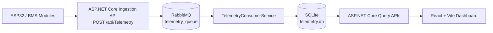

The main data flow is:

```text
ESP32 / BMS
    ↓
ASP.NET Core ingestion API
    ↓
RabbitMQ: telemetry_queue
    ↓
TelemetryConsumerService
    ↓
SQLite
    ↓
ASP.NET Core APIs
    ↓
React / Vite dashboard
```

## Technology Stack

### Backend

- .NET 8
- ASP.NET Core Web API
- Entity Framework Core
- SQLite
- RabbitMQ.Client
- JSON Web Tokens (JWT)
- BCrypt.Net-Next
- MailKit
- Swagger / OpenAPI

### Frontend

- React
- Vite
- React Router
- Recharts
- Tailwind CSS

### Simulation

- `BmsStressTest` — .NET 8 console application for telemetry simulation and stress testing.

## Repository Structure

```text
TelemetryApi/
├── TelemetryApi/         # ASP.NET Core API and background telemetry consumer
├── frontend/             # React + Vite dashboard
├── BmsStressTest/        # Console telemetry simulator and stress test
└── docker-compose.yml    # Local infrastructure configuration
```

## Prerequisites

- Git
- .NET 8 SDK
- Node.js and npm
- Docker Desktop with Docker Compose

## Local Setup and Run Guide

### 1. Clone the repository

```bash
git clone https://github.com/RazvanMurgu27/TelemetryApi.git
cd TelemetryApi
```

### 2. Start RabbitMQ

From the repository root, start RabbitMQ using Docker Compose:

```bash
docker compose up -d rabbitmq
```

RabbitMQ Management UI is available at:

```text
http://localhost:15672
```

Use the credentials configured in `docker-compose.yml`. Do not commit production credentials to the repository.

As an alternative, RabbitMQ can be started with Docker directly:

```bash
docker run -d \
  --name telemetry_rabbitmq \
  -p 5672:5672 \
  -p 15672:15672 \
  rabbitmq:3-management
```

### 3. Run the backend

Open a terminal at the repository root and run:

```bash
cd TelemetryApi
dotnet restore
dotnet run
```

The backend URL and HTTPS port are displayed in the terminal at startup. They can also be checked in:

```text
TelemetryApi/Properties/launchSettings.json
```

### 4. Run the frontend

Open a second terminal at the repository root:

```bash
cd frontend
npm install
```

Create `frontend/.env` and set the backend URL:

```env
VITE_API_URL=https://localhost:<BACKEND_PORT>
```

Replace `<BACKEND_PORT>` with the actual HTTPS port reported by the backend.

Start the frontend:

```bash
npm run dev
```

Open the URL displayed by Vite in the terminal, commonly `http://localhost:5173`.

## Secure Configuration

Do not commit JWT keys, SMTP passwords, application passwords, or other sensitive values to the repository.

The backend reads sensitive configuration values such as:

- `Jwt:Key`
- `EmailSettings:Email`
- `EmailSettings:Password`

For local development, use .NET User Secrets from the `TelemetryApi/` directory:

```bash
dotnet user-secrets init
dotnet user-secrets set "Jwt:Key" "replace-with-a-long-random-key"
dotnet user-secrets set "EmailSettings:Email" "your-email@example.com"
dotnet user-secrets set "EmailSettings:Password" "your-app-password"
```

Environment variables can also be used with the corresponding double-underscore notation:

```text
Jwt__Key
EmailSettings__Email
EmailSettings__Password
```

## Data Seeding

At startup, the backend:

1. Ensures that the SQLite database exists.
2. Seeds demo data only when the database is empty.
3. Adds a demo BMS module with `DeviceId = SIM-001`.
4. Generates time-series telemetry history.
5. Includes anomaly scenarios for alert visualization and testing.

To inspect or change the demo data, edit:

```text
TelemetryApi/Data/DataSeeder.cs
```

For security, this README intentionally does not expose demo credentials.

## BMS Stress Test Simulator

Run the simulator from the repository root:

```bash
dotnet run --project BmsStressTest
```

The simulator supports:

- An optional custom `DeviceId` or randomly generated IDs from `SIM-001` to `SIM-050`.
- 12V, 24V, and 48V battery systems, represented as 4S, 8S, and 16S configurations.
- A configurable message publishing interval in milliseconds.
- Publishing telemetry messages to the RabbitMQ `telemetry_queue` queue.

Stop the simulator with `CTRL+C`.

## API Endpoints

The following routes match the existing controllers in `TelemetryApi/Controllers`.

### Public endpoints

- `POST /api/Auth/register`
- `POST /api/Auth/login`
- `POST /api/Telemetry`

### JWT-protected endpoints

- `GET /api/Telemetry/battery/{deviceId}`
- `POST /api/Bms`
- `GET /api/Bms/user/{userId}`
- `DELETE /api/Bms/user/{deviceId}`
- `GET /api/Settings/battery/{deviceId}`
- `PUT /api/Settings`

Protected endpoints require a valid JWT in the `Authorization` header.

## Swagger / OpenAPI

All API endpoints can be viewed and tested through the Swagger / OpenAPI interface while the backend is running in Development mode.

Open the following URL, replacing `<BACKEND_PORT>` with the HTTPS port shown in the terminal:

```text
https://localhost:<BACKEND_PORT>/swagger
```

Swagger provides an interactive overview of the available authentication, BMS, settings, and telemetry routes. It can also be used to authorize requests with a JWT and test protected endpoints directly from the browser.

Authentication is required to access protected endpoints. Please follow these steps:

1. **Register:** Go to `/api/Auth/register` to create a new account.
2. **Login:** Go to `/api/Auth/login` and enter your credentials to receive a JWT access token.
3. **Authorize:** Click the 'Authorize' button at the top of the Swagger page and input your token in the following format: `Bearer {your_token}`.
## Screenshots

### Dashboard Overview

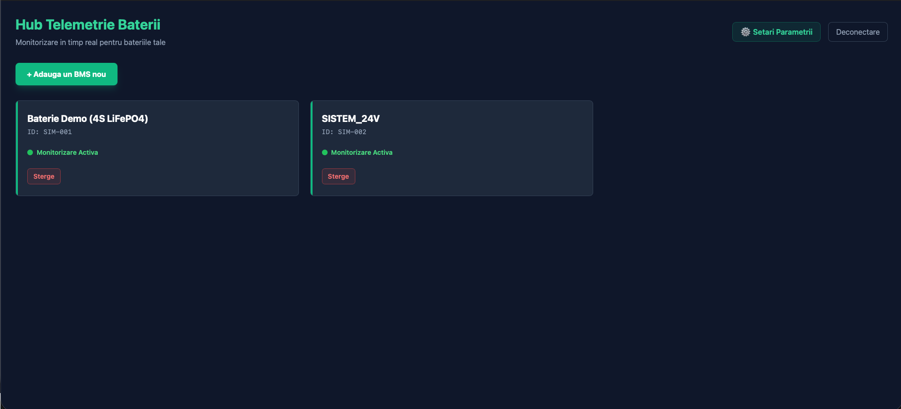

Overview of the dashboard with battery status indicators and operational summary metrics.

### Battery and Charts

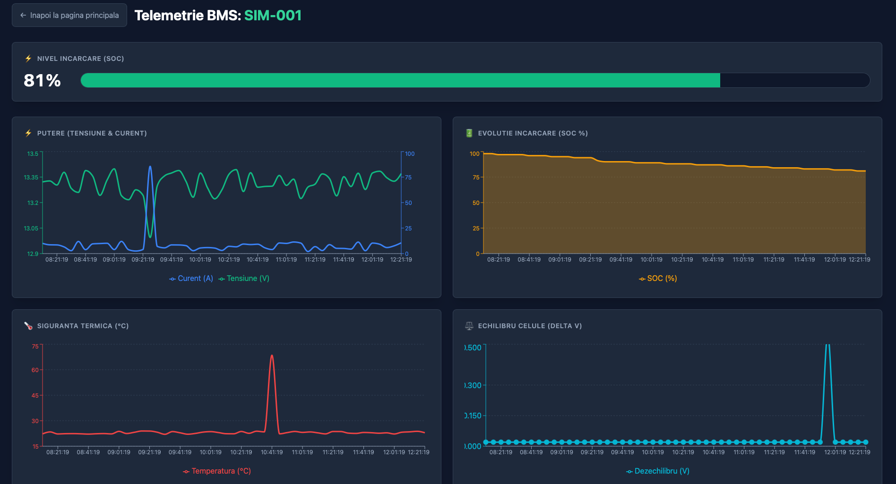

Detailed battery telemetry view with historical charts and key electrical measurements.

### Telemetry History and Alerts

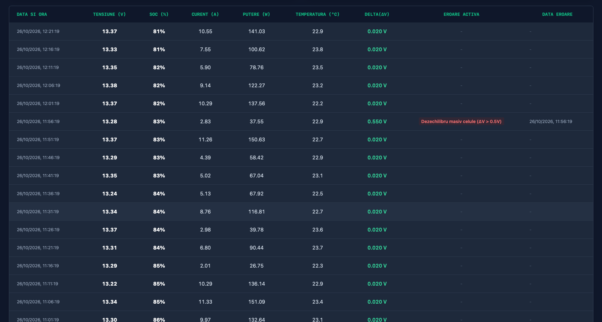

Telemetry history table highlighting recorded measurements and active anomaly alerts.

### Battery Safety Settings

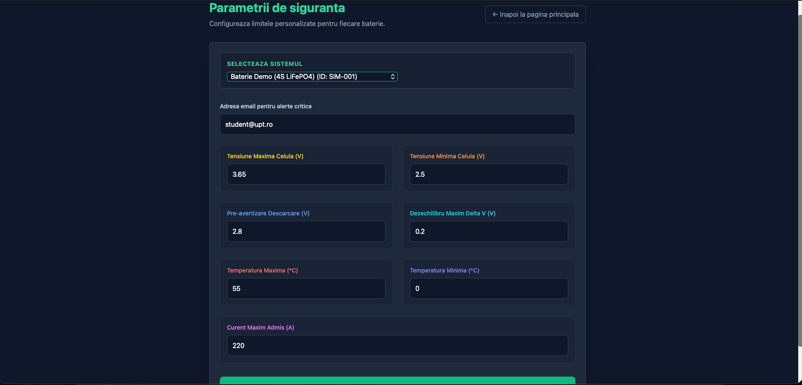

Safety parameter configuration page for battery thresholds and protection settings.

## Login and Sign Up

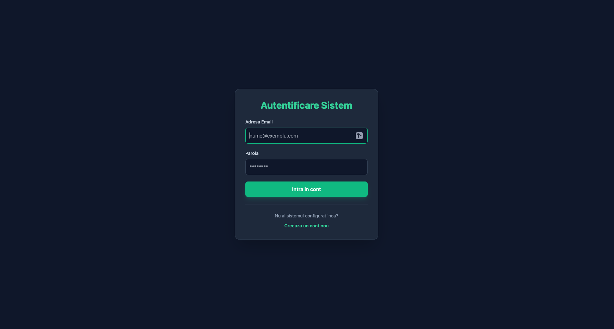

Secure Authentication Portal: Implements stateless JWT (JSON Web Token) authorization with BCrypt password hashing to protect user accounts, hardware telemetry configurations, and API endpoints.

## Swagger

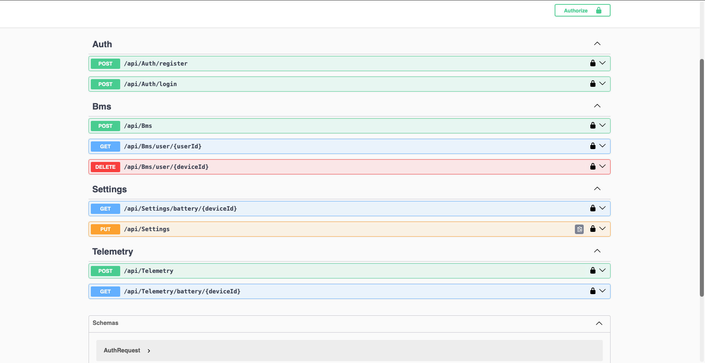

Interactive API Documentation: The Swagger UI provides a comprehensive overview of all RESTful endpoints, logically grouped by controllers. It includes built-in JWT authorization for seamless in-browser testing of protected routes.

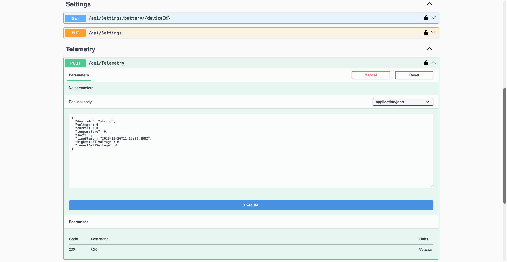

Detailed Endpoint Schema: Expanding an API route reveals the expected JSON request payloads, response models, and specific data types required for integration

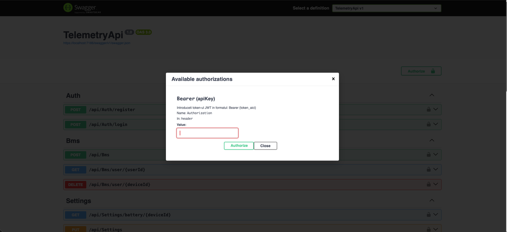

JWT Authorization Modal: Users can securely authenticate by entering their Bearer token to unlock and test protected API routes.


## RabbitMQ

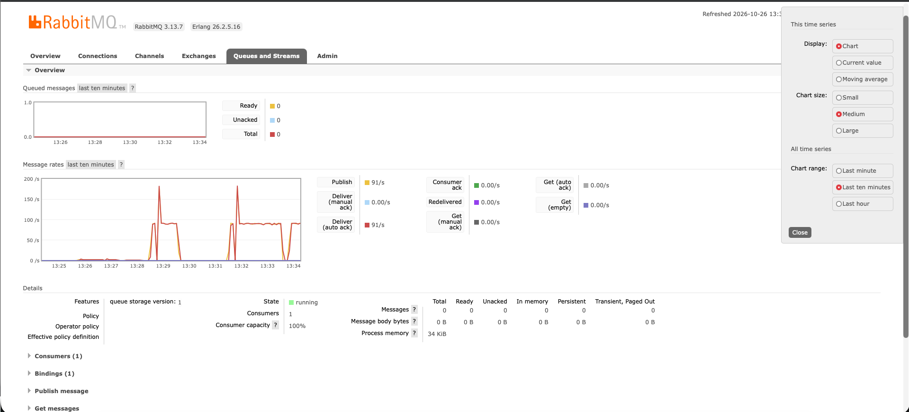

RabbitMQ Management UI during a backend stress test. The telemetry_queue handles high-throughput simulated BMS traffic with perfectly synchronized publish and consume rates, resulting in a zero-message backlog.

## Stress Test

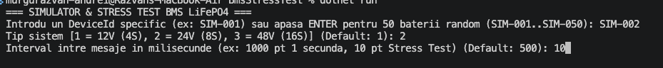
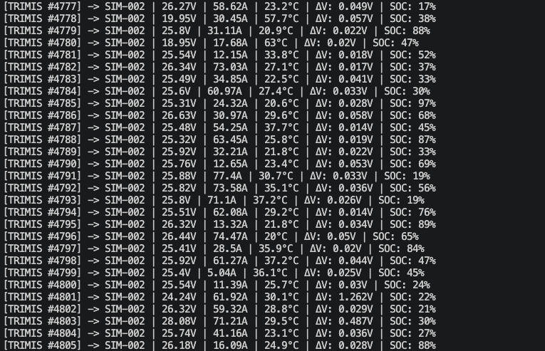
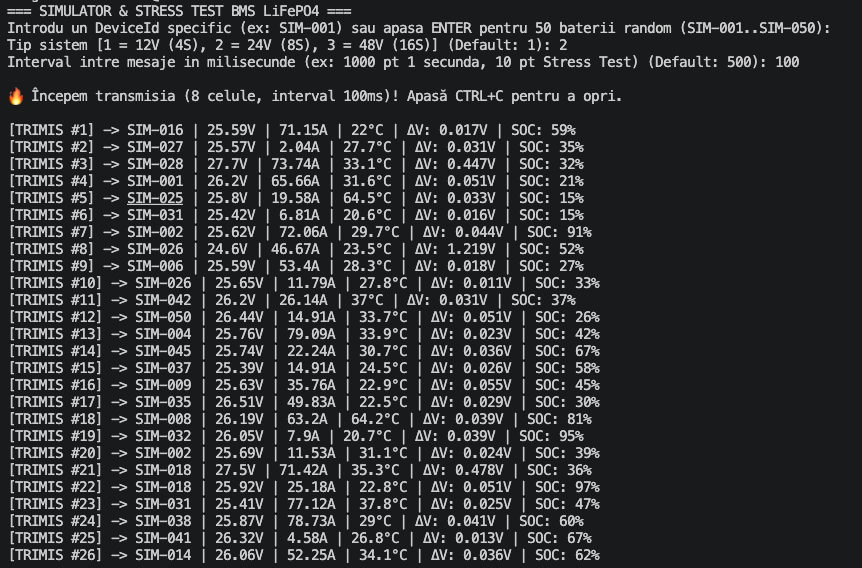

BMS Stress Test Simulator: A custom .NET console application generating and publishing high-throughput simulated battery telemetry to RabbitMQ to validate backend performance.

## Current Limitations

- The current infrastructure is optimized for local development and demonstration using SQLite and a local RabbitMQ instance.
- Queue reliability features such as retries, dead-letter queues, and advanced durability are limited in the current implementation.
- Production deployment and environment-specific configuration are not fully documented yet.

## Future Improvements

- Add a production-ready RabbitMQ topology with durable queues, dead-letter queues, and retry policies.
- Add automated tests for critical API and consumer flows.
- Expand observability with structured logging, metrics, health checks, and distributed tracing.
- Add containerized and cloud deployment profiles.
- Add a production database and migration/backup strategy.

## License

No `LICENSE` file is currently defined in this repository. Add an explicit license if the project is intended to be reused or distributed publicly.