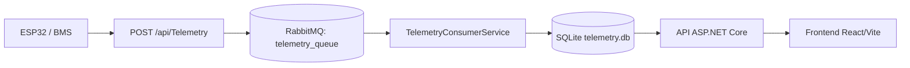

# IoT Smart Battery Management System (BMS) & Telemetry Platform

Platformă pentru monitorizarea telemetriei BMS, cu ingestie asincronă prin RabbitMQ, persistență SQLite și dashboard web React pentru vizualizare și configurare.

## Cuprins
- [Funcționalități principale](#funcționalități-principale)
- [Arhitectură](#arhitectură)
- [Tehnologii](#tehnologii)
- [Structura repository-ului](#structura-repository-ului)
- [Prerechizite](#prerechizite)
- [Instalare și rulare](#instalare-și-rulare)
- [Configurarea secretelor](#configurarea-secretelor)
- [Data Seeder](#data-seeder)
- [BMS Stress Test](#bms-stress-test)
- [Endpoint-uri API documentate în cod](#endpoint-uri-api-documentate-în-cod)
- [Capturi de ecran](#capturi-de-ecran)
- [Limitări și îmbunătățiri viitoare](#limitări-și-îmbunătățiri-viitoare)
- [Licență](#licență)

## Funcționalități principale
- Autentificare și înregistrare utilizatori cu JWT (`/api/Auth`).
- Înrolare și administrare module BMS per utilizator (`/api/Bms`).
- Ingestie telemetrie prin API și procesare asincronă cu RabbitMQ (`telemetry_queue`).
- Consumer de fundal (`TelemetryConsumerService`) pentru validări, alerte și salvare în SQLite.
- Istoric telemetrie per baterie (ultimele 100 înregistrări) pentru dashboard.
- Configurare praguri de siguranță per baterie (`/api/Settings`) cu fallback implicit.
- Interfață React/Vite pentru login, dashboard, detalii baterie și setări.

## Arhitectură
Flux principal (producție):

ESP32/BMS → API ingestie → RabbitMQ (`telemetry_queue`) → `TelemetryConsumerService` → SQLite → API securizat → React dashboard



Descriere alternativă: dispozitivul trimite telemetrie către API, API-ul publică mesajul în coadă, consumerul procesează și persistă datele, iar frontend-ul citește datele prin endpoint-uri securizate.

## Tehnologii
### Backend (`TelemetryApi/`)
- .NET 8 / ASP.NET Core Web API
- Entity Framework Core + SQLite
- RabbitMQ.Client
- JSON Web Tokens (JWT)
- BCrypt.Net-Next
- MailKit
- Swagger/OpenAPI (în Development)

### Frontend (`frontend/`)
- React + Vite
- React Router
- Recharts
- Tailwind CSS

### Simulator (`BmsStressTest/`)
- .NET 8 Console App
- RabbitMQ.Client

## Structura repository-ului
```text
TelemetryApi/
├── TelemetryApi/        # API ASP.NET Core + worker (consumer RabbitMQ)
├── frontend/            # aplicație web React/Vite
├── BmsStressTest/       # simulator de telemetrie BMS
└── docker-compose.yml   # servicii locale (RabbitMQ + PostgreSQL)
```

## Prerechizite
- Git
- .NET 8 SDK
- Node.js + npm
- Docker (pentru RabbitMQ)

## Instalare și rulare
### 1) Clonare repository
```bash
git clone https://github.com/RazvanMurgu27/TelemetryApi.git
cd TelemetryApi
```

### 2) Pornire RabbitMQ (configurația din `docker-compose.yml`)
```bash
docker compose up -d rabbitmq
```

RabbitMQ pornește cu:
- container: `telemetry_rabbitmq`
- AMQP: `localhost:5672`
- Management UI: `http://localhost:15672`
- utilizator implicit: `guest`
- parolă implicită: `guest`

Alternativ (`docker run`, echivalent):
```bash
docker run -d --name telemetry_rabbitmq \
  -p 5672:5672 -p 15672:15672 \
  -e RABBITMQ_DEFAULT_USER=guest \
  -e RABBITMQ_DEFAULT_PASS=guest \
  rabbitmq:3-management-alpine
```

### 3) Backend (`TelemetryApi/`)
```bash
cd TelemetryApi
dotnet restore
dotnet run
```

Observații:
- Swagger/OpenAPI este disponibil în mediul Development.
- URL-ul/portul activ se verifică în terminal la pornire sau în `TelemetryApi/Properties/launchSettings.json`.

### 4) Frontend (`frontend/`)
Într-un terminal nou, din rădăcina repository-ului:

```bash
cd frontend
npm install
```

Creează `frontend/.env` cu URL-ul backend-ului (valoarea exactă din terminal sau `launchSettings.json`):

```bash
cat > .env <<'ENV'
VITE_API_URL=https://localhost:<PORT_BACKEND>
ENV
```

Apoi pornește aplicația:

```bash
npm run dev
```

## Configurarea secretelor
Nu publica în repository chei JWT, parole SMTP sau alte credențiale.

### Variantă recomandată (User Secrets, local development)
Din folderul `TelemetryApi/`:

```bash
dotnet user-secrets init
dotnet user-secrets set "Jwt:Key" "schimba-cu-o-cheie-puternica"
dotnet user-secrets set "EmailSettings:Password" "schimba-cu-parola-smtp"
```

### Variantă alternativă (variabile de mediu)
Setează variabilele de mediu corespunzătoare înainte de rulare (ex.: `Jwt__Key`, `EmailSettings__Password`).

## Data Seeder
La pornirea backend-ului:
- se creează baza SQLite (`telemetry.db`) dacă nu există;
- se rulează seeding doar când baza este goală (`if (context.Users.Any()) return;`);
- se adaugă date demo, inclusiv:
  - un utilizator demo;
  - un modul BMS cu `DeviceId = SIM-001`;
  - istoric de telemetrie (serii temporale);
  - scenarii de anomalie (supracurent, supra-temperatură, dezechilibru celule).

Înainte de utilizare, verifică și ajustează valorile demo direct în `TelemetryApi/Data/DataSeeder.cs`.

## BMS Stress Test
Rulează simulatorul din rădăcina repository-ului:

```bash
dotnet run --project BmsStressTest
```

Comportament conform implementării:
- `DeviceId` poate fi introdus manual (opțional) sau se folosesc ID-uri random (`SIM-001..SIM-050`);
- suportă sisteme 12V / 24V / 48V (4S / 8S / 16S);
- intervalul dintre mesaje se configurează în milisecunde;
- simulatorul publică mesaje în `telemetry_queue`;
- oprire cu `CTRL+C`.

## Endpoint-uri API documentate în cod
Conform controllerelor din `TelemetryApi/Controllers`:

### Auth
- `POST /api/Auth/register`
- `POST /api/Auth/login`

### BMS (JWT)
- `POST /api/Bms`
- `GET /api/Bms/user/{userId}`
- `DELETE /api/Bms/user/{deviceId}`

### Settings (JWT)
- `GET /api/Settings/battery/{deviceId}`
- `PUT /api/Settings`

### Telemetry
- `POST /api/Telemetry` (ingestie, publică în RabbitMQ)
- `GET /api/Telemetry/battery/{deviceId}` (JWT, ultimele 100 înregistrări)

## Capturi de ecran
Adaugă imaginile în repository și înlocuiește placeholder-ele de mai jos:

- `[PLACEHOLDER] Dashboard principal (lista bateriilor + status)`
- `[PLACEHOLDER] Battery Details / Charts (tensiune, curent, temperatură, SOC)`
- `[PLACEHOLDER] Settings (praguri și email alertă)`
- `[PLACEHOLDER] Swagger/OpenAPI (endpoint-uri API)`
- `[PLACEHOLDER] RabbitMQ Management (coada telemetry_queue)`

## Limitări și îmbunătățiri viitoare
- Configurația conexiunii RabbitMQ este parțial hardcodată în consumer și poate fi unificată complet prin `IConfiguration`.
- Persistența este locală (SQLite), potrivită pentru dezvoltare/demo; pentru producție este utilă o strategie de migrare și backup.
- Se poate extinde observabilitatea (metrics/tracing/log aggregation) pentru diagnostic avansat.

## Licență
Repository-ul nu definește în prezent un fișier `LICENSE`. Adaugă o licență explicită dacă proiectul va fi distribuit public.
